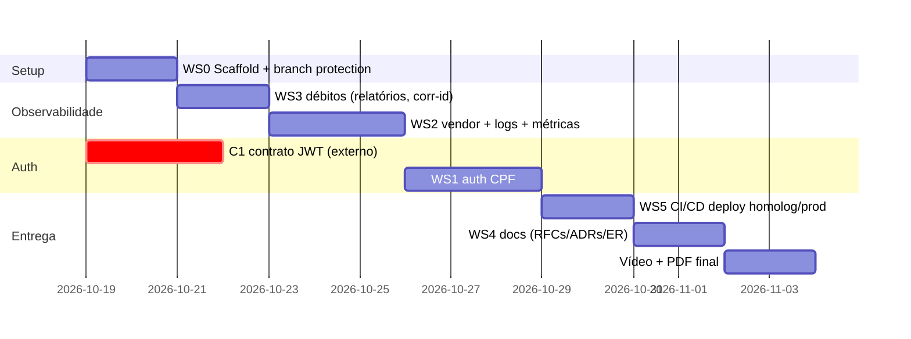

# Plano de Refactor — Fase 3

> Repositório de destino: [FernandoGreco/techChallengePosTech-Aplication](https://github.com/FernandoGreco/techChallengePosTech-Aplication)
> Escopo do autor: **Repo 4 — Aplicação principal executando em Kubernetes**
> Fonte: `13SOAT - Fase 3 - Tech Challenge.pdf` + análise do código da Fase 2 (`main` @ 266c68b)

---

## 1. Entendimento do escopo

A Fase 3 **não exige microsserviços nem mensageria**. O refactor do seu repositório se resume a 4 frentes:

1. **Autenticação** — app deixa de emitir JWT próprio e passa a **consumir JWT emitido pela Lambda** (auth via CPF), atrás de um **API Gateway**.
2. **Observabilidade** — sair de OpenTelemetry/Jaeger (dev local) para **Datadog ou New Relic** com logs JSON estruturados, correlation IDs, métricas de negócio, dashboards e alertas.
3. **Segregação de repositórios** — extrair `/infra` (vai para os repos 2 e 3 dos colegas), manter a app + manifestos K8s + CI/CD no repo novo.
4. **Documentação arquitetural** — diagrama de componentes, diagrama de sequência (auth + abertura de OS), **RFCs**, **ADRs**, diagrama ER + justificativa do banco.

A Clean Architecture, os 251 testes e a máquina de estados da OS **são preservados** — são o maior ativo do projeto.

---

## 2. Matriz de rastreabilidade (requisito do PDF → tarefa)

| # | Requisito do PDF | Onde cai | Tarefa(s) | Esforço |
|---|---|---|---|---|
| R1 | API Gateway (Kong/Traefik/AWS) | Infra compartilhada + app | App: aceitar tráfego do gateway, confiar em headers propagados, documentar contrato (rate limit, CORS, auth no gateway) | P |
| R2 | Proteger rotas sensíveis com autenticação via CPF | `src/modules/auth` | Reescrever `JwtStrategy` para validar token da Lambda (claims com CPF); decidir modelo dual cliente×staff (ver D1) | M |
| R3 | Lambda: validar CPF, consultar cliente, emitir JWT | **Repo 1 (colega)** | Seu papel: expor endpoint de consulta de cliente por CPF (`GET /clientes/documento/:documento` já existe) e fechar o contrato do JWT (ver C1) | P |
| R4 | 4 repositórios com CI/CD e deploy automático | Repo novo | Scaffold, copiar código sem `/infra`, branch protection, pipeline adaptada | M |
| R5 | Banco gerenciado (RDS) | **Repo 3 (colega)** | Seu papel: consumir `DATABASE_URL` via Secret; remover Postgres local do compose de produção | P |
| R6 | Cluster K8s com escalabilidade | **Repo 2 (colega)** + app | Seu papel: manter manifests da app (deployment/service/hpa) e healthchecks `/health` + `/ready` para probes | P |
| R7 | Monitoramento Datadog/New Relic | App + cluster | Trocar `tracing.ts` pelo agente do vendor; instrumentar métricas customizadas de OS | M |
| R8 | Logs estruturados JSON + correlação | App | Logger estruturado (nestjs-pino) com `trace-id`/correlation-id propagado | M |
| R9 | Dashboards: volume diário OS, tempo médio por status, erros de integração | App → vendor | Métricas customizadas (`os.created`, `os.status_transition`, `os.integration_error`); queries no Datadog/New Relic | M |
| R10 | Alertas para falhas em OS | Vendor + app | Métricas de falha nas transições críticas (estoque insuficiente, email falhou, orçamento recusado) → alertas no vendor | P |
| R11 | Docs: componentes, sequência, RFCs, ADRs, ER | Repo novo | Nova pasta `docs/` (ver WS4) | M |
| R12 | Branch protection, PR obrigatório, deploy homolog+prod | Repo novo | Settings do GitHub + pipeline com deploy de `develop` (homolog) e `main` (prod) | P |
| R13 | Vídeo 15 min | Grupo | Roteiro + gravação após M4 | — |

Esforço: P = pequeno (< 1 dia) · M = médio (1–3 dias) · G = grande (> 3 dias)

---

## 3. Workstreams detalhados

### WS0 — Scaffold do novo repositório
**Objetivo:** repo novo rodando, com CI verde, sem os artefatos que migram para os colegas.

- [ ] Criar estrutura local `techChallengePosTech-Aplication` (ou clonar o repo remoto vazio)
- [ ] Copiar do repo atual: `src/`, `prisma/`, `test/`, `Dockerfile`, `docker-compose.yml`, `package.json`, `tsconfig*`, `eslint.config.mjs`, `nest-cli.json`, `k8s/` (manifests da app), `.github/workflows/`
- [ ] **Remover:** `infra/` (Terraform vai para repos 2 e 3), `relatorio-vulnerabilidades-dependencias.json`, PDFs
- [ ] Ajustar `docker-compose.yml`: manter Postgres + app para dev local; Jaeger sai (ou fica opcional até o vendor entrar)
- [ ] Commit inicial na `main` → push → habilitar **branch protection** (PR obrigatório, sem push direto) — requisito R12
- [ ] Criar branch `develop` (homologação)
- [ ] Rodar `npm test` + `npm run test:e2e` no repo novo — baseline verde (251 testes)

**Critério de pronto:** CI passando no repo novo; proteção de branch ativa; `develop` e `main` existentes.

---

### WS1 — Autenticação via CPF (maior risco técnico)
**Objetivo:** app valida JWT emitido pela Lambda e autoriza rotas sensíveis.

**Contexto:** hoje o app é emissor — [login.use-case.ts](src/modules/auth/application/use-cases/login.use-case.ts) valida email+senha (bcrypt) e assina JWT com `JWT_SECRET`. Na Fase 3, a Lambda faz auth por CPF consultando o banco e **emite** o token.

- [ ] **D1 (decisão — virar RFC): modelo dual de auth**
  - Cliente → Lambda (CPF) → JWT → rotas públicas/sensíveis de cliente
  - Staff (ADMIN/ATENDENTE/MECANICO) → mantém login interno? Ou tudo migra para a Lambda com claim de papel?
  - **Recomendação:** aceitar dois emissores no guard (multi-issuer) — Lambda para clientes, emissor interno para staff — e documentar na RFC. Menor ruptura com os testes atuais.
- [ ] **C1 (contrato com o colega da Lambda — BLOQUEADOR):**
  - Algoritmo: **HS256 com secret compartilhado** (simples) × **RS256 com JWKS** (correto para produção)
  - Claims mínimos: `sub` (clienteId), `cpf`, `iat`, `exp`, `iss`
  - TTL do token e tratamento de expiração
  - Formato de erro da Lambda (401 vs 403)
- [ ] Reescrever `JwtStrategy.validate()` para o novo shape de payload (extrair `cpf`/`sub`)
- [ ] Endpoint da Lambda → app: garantir que `GET /clientes/documento/:documento` atenda à consulta de existência/status da Lambda (já existe; verificar se precisa de campo `status`/`ativo` no cliente — hoje não existe → possível migration)
- [ ] Tornar `/auth/login` interno (staff) ou depreciá-lo conforme D1
- [ ] Atualizar testes de auth (strategy, guard, controller) para o novo emissor
- [ ] Swagger: atualizar fluxo de authorize (token vem da Lambda, não mais do `/auth/login` — documentar como obter token no README)

**Critério de pronto:** rotas sensíveis rejeitam token inválido/expirado, aceitam token da Lambda; testes verdes; contrato C1 documentado em `docs/rfc/`.

---

### WS2 — Observabilidade (Datadog × New Relic)
**Objetivo:** substituir Jaeger/OTel por APM de mercado + logs JSON + métricas de negócio.

- [ ] **D2 (decisão — virar RFC): Datadog × New Relic**
  - Ambos têm free tier; Datadog tem integração K8s mais madura (DaemonSet), New Relic tem free tier generoso (100 GB/mês)
  - **Recomendação:** Datadog (melhor story para dashboards de negócio + alertas), com fallback New Relic
- [ ] Remover `@opentelemetry/*` de [package.json](package.json) e [tracing.ts](src/tracing.ts); adicionar `dd-trace` (ou `newrelic`)
- [ ] Init do agente **antes** de qualquer import no bootstrap (mesmo padrão atual do tracing.ts)
- [ ] **Logs JSON estruturados:** `nestjs-pino` + `pino-http`, formato JSON, nível via env; incluir `correlation-id` (header `x-correlation-id` vindo do API Gateway, gerado se ausente)
- [ ] **Healthchecks** (R6): `@nestjs/terminus` — `GET /health` (liveness) e `GET /ready` (readiness com check de DB via `PrismaHealthIndicator`); ligar probes nos manifests [k8s/app-deployment.yaml](k8s/app-deployment.yaml)
- [ ] **Métricas customizadas de negócio** (R9/R10) — instrumentar nos use cases:
  | Métrica | Tipo | Onde |
  |---|---|---|
  | `oficina.os.criada` | counter | `CriarOrdemServicoUseCase` |
  | `oficina.os.status_transition` | counter (tags: de/para) | `OrdemServicoPrismaRepository.transicionarStatus` |
  | `oficina.os.falha_estoque_insuficiente` | counter | `AprovarOrcamentoUseCase` |
  | `oficina.integracao.email.erro` | counter | `EmailNotificacaoOrcamentoService` |
  | `oficina.os.tempo_status` | histogram (por status) | derivado de `HistoricoStatusOS` |
- [ ] Dashboards no vendor: volume diário de OS, tempo médio por status (Diagnóstico/Execução/Finalização — mesma base do relatório atual), erros de integração
- [ ] Alertas: taxa de `falha_estoque_insuficiente` e `integracao.email.erro` acima de threshold → notificação
- [ ] Capturar prints/links dos dashboards para o README e o vídeo

**Critério de pronto:** traces + logs JSON + métricas visíveis no vendor em ambiente de homolog; dashboards com os 3 painéis obrigatórios; 1 alerta configurado e disparado em teste.

---

### WS3 — Qualidade / débitos técnicos (necessário para WS2)
- [ ] **`RelatoriosController` injeta `PrismaService` direto** ([relatorios.controller.ts](src/modules/relatorios/presentation/controllers/relatorios.controller.ts)) — criar `TempoMedioServicosUseCase` + `IRelatorioRepository` (mesmo padrão dos demais módulos). **Necessário** porque o dashboard de tempo médio por status vai consumir essa lógica/métrica.
- [ ] Adicionar testes do novo use case de relatório (hoje só há 2 testes do controller)
- [ ] Correlation-id middleware + propagar para logs e traces
- [ ] (Opcional) revisar `relatorio-vulnerabilidades-dependencias.json` e rodar `npm audit` no pipeline

**NÃO fazer nesta fase:** quebrar as transações multi-agregado de OS (orçamento/estoque), eventos/outbox, microsserviços — nada disso é exigido e o risco não se paga.

---

### WS4 — Documentação arquitetural (`docs/`)
- [ ] `README.md` novo: propósito, tecnologias, execução, deploy, diagrama da arquitetura **deste repo**, link Swagger, links dos outros 3 repos
- [ ] `docs/architecture/componentes.md` — diagrama C4-nível-2: API Gateway → Lambda → App K8s → RDS → Datadog (mermaid)
- [ ] `docs/architecture/sequencia-auth-os.md` — 2 diagramas de sequência: (a) auth via CPF na Lambda; (b) abertura de OS autenticada
- [ ] `docs/rfc/` — decisões técnicas **voláteis**:
  - RFC-001 escolha da nuvem (AWS)
  - RFC-002 escolha do banco (PostgreSQL/RDS) — reusar ADR-01 da Fase 2 como base
  - RFC-003 estratégia de autenticação (Lambda + CPF + JWT — decisão D1)
  - RFC-004 ferramenta de observabilidade (decisão D2)
- [ ] `docs/adr/` — decisões **permanentes**:
  - ADR-001 monólito modular Clean Architecture (migrar da Fase 2)
  - ADR-002 padrão de comunicação síncrona REST via API Gateway
  - ADR-003 HPA para escalabilidade (migrar da Fase 2)
  - ADR-004 logs estruturados + correlation-id
- [ ] `docs/database/modelo-er.md` — diagrama ER (mermaid a partir do [schema.prisma](prisma/schema.prisma)) + justificativa formal do relacional + relacionamentos + ajustes de modelo (ex.: campo `ativo`/`status` em Cliente se a Lambda precisar)
- [ ] Swagger publicado/linkado no README

---

### WS5 — CI/CD
- [ ] Adaptar `.github/workflows/ci-cd.yml`:
  - **Remover** stage de Terraform/deploy EC2 (infra sai do repo)
  - **Manter:** lint, unit tests, coverage, e2e (Postgres efêmero), build, docker build/push GHCR
  - **Adicionar:** deploy via `kubectl apply` (ou helm) no cluster provisionado pelo repo 2 — `develop` → namespace homolog, `main` → namespace prod (R12)
- [ ] Secrets do repo: kubeconfig/credenciais do cluster (combinar com o dono do repo 2), `DATABASE_URL` de homolog/prod (do repo 3), chaves do vendor de observabilidade
- [ ] Badge de pipeline no README

---

## 4. Contratos a fechar com o grupo (bloqueadores externos)

| # | Com quem | O que definir | Impacto se atrasar |
|---|---|---|---|
| C1 | Dono da Lambda (repo 1) | Assinatura do JWT (HS256 secret × RS256 JWKS), claims, TTL, formato de erro | **Bloqueia WS1 inteiro** — puxar essa conversa primeiro |
| C2 | Dono da infra DB (repo 3) | Entrega de `DATABASE_URL` (Secrets Manager × K8s Secret × GitHub Secret), schema/migrations (quem roda `prisma migrate deploy`?) | Deploy de homolog |
| C3 | Dono da infra K8s (repo 2) | Quem aplica os manifests da app; namespaces homolog/prod; onde mora o API Gateway; Metrics Server p/ HPA | Deploy de homolog + HPA |
| C4 | Grupo | Ferramenta de observabilidade única (todos os repos reportam no mesmo vendor) | Dashboards fragmentados |

> **Ação imediata:** abrir issues no repo do grupo (ou mensagem) propondo C1–C4 com as recomendações acima. Isso destrava o planejamento de todos.

---

## 5. Sequenciamento

Ordem racional: **WS0 → WS3 → WS2 → WS1 → WS5 → WS4 → vídeo**. WS1 pode começar antes se C1 fechar cedo; WS4 pode ser escrito em paralelo.

---

## 6. Riscos

| Risco | Mitigação |
|---|---|
| Contrato do JWT com a Lambda não fechar a tempo | Definir HS256+secret compartilhado como default provisório; abstrair verificação no `JwtStrategy` para trocar por JWKS depois |
| Free tier Datadog/New Relic insuficiente para K8s completo | Instrumentar só o namespace da app; métricas customizadas têm limite — manter enxuto (5 métricas da tabela) |
| Modelo dual de auth (cliente × staff) complicar o guard | Isolar em dois strategies NestJS (`lambda-jwt` e `staff-jwt`); testes dedicados para cada emissor |
| Vídeo exige deploy ativo + dashboards funcionando | Não deixar WS5/dashboards para a última semana; gravar ambiente de homolog se prod atrasar |
| Migration de `Cliente` (campo ativo/status p/ Lambda) | Pequena e retrocompatível; incluir no WS1 com teste e2e |
| Deploy automático de homolog e prod (R12) depende do cluster do colega | Ter fallback: deploy no Docker Desktop/kind local gravado no vídeo + pipeline de prod pronta aguardando cluster |

---

## 7. Checklist de entregáveis (do PDF)

**Repo 4 (seu):**
- [ ] Código + Dockerfile + CI/CD funcional
- [ ] README: propósito, tecnologias, execução, deploy, diagrama da arquitetura do repo, link Swagger
- [ ] Deploy automático de `develop` (homolog) e `main` (prod)
- [ ] Branch `main` protegida + PR obrigatório
- [ ] Healthchecks, logs JSON, métricas, dashboards, alertas
- [ ] RFCs + ADRs + ER + diagrama de sequência
- [ ] Usuário `soat-architecture` adicionado ao repo

**PDF final no portal:**
- [ ] Links dos 4 repos
- [ ] Link do vídeo (≤ 15 min)
- [ ] Links das documentações
- [ ] Confirmação do `soat-architecture` em todos os repos

**Roteiro do vídeo (ordem do PDF):** auth com CPF → pipeline executando → deploy automatizado → consumo de API protegida → dashboard com análise ao vivo → logs/traces.
