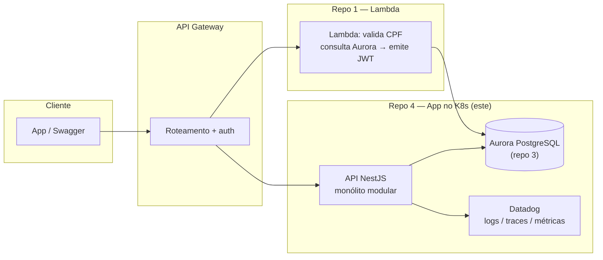

# Oficina Mecânica — Aplicação Principal (Fase 3)

> **Repo 4 de 4** — API NestJS executando em Kubernetes, parte do Tech Challenge da Pós-Tech FIAP (Fase 3).
> Esta é a aplicação principal do sistema de gestão de oficina mecânica.

## Visão geral

Sistema de gestão para oficina mecânica: clientes, veículos, serviços, peças,
ordens de serviço (OS), orçamentos, estoque e relatórios. **Monólito modular**
em NestJS com Clean Architecture, PostgreSQL (RDS em produção), observabilidade
Datadog e autenticação via Lambda (clientes, por CPF) + staff interno.

### Os 4 repositórios do grupo

| Repo | Escopo |
|---|---|
| [techChallengePosTech-auth](https://github.com/FernandoGreco/techChallengePosTech-auth) | Lambda de auth por CPF + API Gateway (repo 1) 
| [techChallengePosTech-k8s-infra](https://github.com/FernandoGreco/techChallengePosTech-k8s-infra) | Cluster K8s (Terraform, EC2, kubeadm) 
| [techChallengePosTech-db-infra](https://github.com/FernandoGreco/techChallengePosTech-db-infra) | Aurora PostgreSQL (Terraform) |
| **techChallengePosTech-Aplication** | **API + K8s manifests + CI/CD (este repo)** 

## Arquitetura deste repositório



Ver [docs/architecture/componentes.md](docs/architecture/componentes.md) para o
diagrama C4-nível-2 completo e
[docs/architecture/sequencia-auth-os.md](docs/architecture/sequencia-auth-os.md)
para os fluxos de autenticação e abertura de OS.

## Tecnologias

- **NestJS 11** (Node.js, TypeScript) — monólito modular
- **Prisma** + PostgreSQL-compatible Aurora (produção)
- **JWT** — multi-issuer: Lambda (clientes, CPF) + staff interno (ver [RFC-003](docs/rfc/RFC-003-estrategia-autenticacao.md))
- **Datadog** (`dd-trace`) — APM, logs JSON, métricas de negócio (ver [RFC-004](docs/rfc/RFC-004-observabilidade-datadog.md))
- **Docker** + **Kubernetes** (manifests em [k8s/](k8s/))
- **GitHub Actions** — CI/CD

## Executando localmente

```bash
# 1. Subir Postgres (Docker)
docker compose up db -d

# 2. Configurar variáveis
cp .env.example .env

# 3. Instalar dependências e rodar migrations
npm install
npx prisma migrate deploy
npx prisma db seed   # opcional

# 4. Subir a aplicação
npm run start:dev
```

A API sobe em http://localhost:3000. Healthchecks: `/health` (liveness) e
`/ready` (readiness).

Para executar localmente o build de produção, com o mesmo banco e variáveis:

```bash
npm run build
npm run start:prod
```

### Datadog local para demonstração

O Agent local é opcional e não altera o deploy Kubernetes. Adicione a API key
da sua conta Datadog ao `.env` local (arquivo ignorado pelo Git) e suba somente
o Agent pelo Compose separado, sem iniciar o banco ou a aplicação do Compose:

```powershell
docker compose -f docker-compose.datadog.yml up -d
```

Em outro terminal PowerShell, inicie uma instância da API na porta `3003` para
enviar traces e métricas DogStatsD ao Agent local:

```powershell
$env:DD_AGENT_HOST = '127.0.0.1'
$env:DD_TRACE_AGENT_PORT = '8126'
$env:DD_DOGSTATSD_PORT = '8125'
$env:DD_SERVICE = 'oficina-mecanica-api'
$env:DD_ENV = 'local-demo'
$env:NODE_ENV = 'production'
$env:PORT = '3003'
node -r dotenv/config dist/main.js
```

Abra `http://localhost:3003/api/docs` e gere chamadas/OS de demonstração. Os
traces e métricas da API aparecerão no Datadog; os logs JSON com correlação
podem ser demonstrados no terminal. Esse Agent local não coleta métricas do
cluster Kubernetes.

O build gera `dist/main.js` e armazena o cache incremental dentro de `dist`,
para que o Nest limpe ambos juntos antes de cada compilação.

## Documentação da API (Swagger)

- Local: http://localhost:3000/api/docs
- Homolog: _a publicar após deploy_

## Autenticação

| Tipo de usuário | Como obter o token |
|---|---|
| **Cliente** | Lambda (repo 1) — auth por CPF, emite JWT HS256 |
| **Staff** (ADMIN/ATENDENTE/MECANICO) | `POST /auth/login` com email+senha |

Detalhes em [docs/rfc/RFC-003-estrategia-autenticacao.md](docs/rfc/RFC-003-estrategia-autenticacao.md).

Para desenvolvimento local, execute `npm run prisma:seed` para criar os
usuários de exemplo. O login do administrador em `POST /auth/login` usa:

```json
{
  "email": "admin@email.com",
  "senha": "123456"
}
```

Essas credenciais são apenas para desenvolvimento; não as utilize em produção.

## Testes

```bash
npm test           # testes unitários
npm run test:cov   # cobertura
npm run test:e2e   # e2e (requer Postgres local)
```

**Atenção:** a suíte E2E limpa as tabelas, incluindo usuários, no banco indicado
por `DATABASE_URL`. Execute-a somente em um banco exclusivo para testes.
Se ela tiver sido executada no banco de desenvolvimento, `npm run prisma:seed`
recria as contas de exemplo, mas não recupera os dados removidos.

Para preparar OS sintéticas locais sem recriar cliente, veículo, serviços e peças:

```bash
npm run prisma:seed:scenarios
```

O comando só aceita `DATABASE_URL` local apontando para `oficina_mecanica`,
recria exclusivamente as cinco OS de fixture e preserva os demais registros.
A OS `EM_DIAGNOSTICO` está pronta para testar geração de orçamento/notificação;
ao repetir o seed, as fixtures voltam aos estados iniciais. Defina
`SEED_CLIENT_EMAIL` no `.env` com uma caixa de teste que você controla para
receber o orçamento; sem SMTP configurado, o serviço usa Ethereal e registra
um link de preview nos logs.

## Deploy

- **CI** (`.github/workflows/`): lint, testes unitários + e2e, build e Docker build.
- **CD**: push em `develop` publica e implanta em homolog; push em `main` publica e implanta em produção. O deploy executa migrations Prisma em Job antes do rollout.
- Configure GitHub Environments `homolog` e `prod`, cada um com secrets `KUBE_CONFIG`, `DATABASE_URL`, `JWT_SECRET`, `ORCAMENTO_ACTION_SECRET`, `GHCR_PULL_USERNAME`, `GHCR_PULL_TOKEN`; configure a variable `KUBE_NAMESPACE`. `APP_URL` e as credenciais SMTP são necessárias para links de aprovação e envio de e-mail. Gere `ORCAMENTO_ACTION_SECRET` como um valor aleatório independente e mantenha-o fora do Git.
- No API Gateway do repo Auth, configure GET e POST para `/ordens-servico/{id}/aprovar-orcamento` e `/ordens-servico/{id}/recusar-orcamento` sem o Lambda Authorizer: o GET só mostra confirmação, e o POST valida o token de ação assinado. O GET público `GET /ordens-servico/{id}/status` também precisa ser encaminhado conforme a política do Gateway.
- Para instalar o Datadog Agent, adicione em cada GitHub Environment usado: secret `DATADOG_API_KEY` e variables `DATADOG_SITE` (por exemplo, `datadoghq.com`) e `DATADOG_CLUSTER_NAME` (nome real do cluster). Execute Actions → `Instalar Datadog Agent` e selecione o ambiente. O workflow instala/atualiza o chart oficial como DaemonSet no namespace `datadog`, com APM, DogStatsD e coleta de logs habilitados. Execute uma vez por cluster; se homolog e prod compartilham cluster, não é necessário executar duas vezes.
- O Deployment da aplicação envia traces para `8126` e métricas DogStatsD para `8125` no node local. A chave `DATADOG_API_KEY` fica no Secret do Agent, não na aplicação.
- Consultas para montar o dashboard no Datadog:
    - Volume diário de OS: `sum:oficina.os.criada{*}.as_count()` em um gráfico de série temporal, com intervalo de 1 dia.
    - Tempo médio por status, em milissegundos: `avg:oficina.os.tempo_status{*} by {status}`. Os valores do status são `EM_DIAGNOSTICO`, `EM_EXECUCAO` e `FINALIZADA`.
    - Falhas de integração: `sum:oficina.integracao.email.erro{*}.as_count()`; falhas de processamento por estoque: `sum:oficina.os.falha_estoque_insuficiente{*}.as_count()`.
- Para alertar sobre falhas de processamento, crie um monitor métrico com consulta `sum(last_5m):sum:oficina.os.falha_estoque_insuficiente{*}.as_count() > 0` e configure o destinatário de notificação. Para disponibilidade, monitore `GET <APP_URL>/health` no Datadog após o endpoint estar acessível.
- Latência das APIs aparece no serviço APM `oficina-mecanica-api` depois que os traces forem recebidos. No dashboard Kubernetes, confira CPU/memória, pods e logs coletados pelo Agent. Gere tráfego e transições de OS na aplicação do cluster para alimentar esses painéis; a execução local não envia métricas ao Agent do cluster.
- A aplicação não recebe AWS access keys. O acesso ao Aurora deve ser concedido por rede/credenciais do ambiente, e `DATABASE_URL` fica somente no GitHub Environment/Kubernetes Secret.

## Documentação arquitetural

| Doc | Conteúdo |
|---|---|
| [docs/architecture/componentes.md](docs/architecture/componentes.md) | Diagrama de componentes (C4-nível-2; Lambda consulta Aurora diretamente) |
| [docs/architecture/sequencia-auth-os.md](docs/architecture/sequencia-auth-os.md) | Sequência: auth via CPF + abertura de OS |
| [docs/rfc/](docs/rfc/) | RFC-001 (nuvem) · RFC-002 (banco) · RFC-003 (auth) · RFC-004 (observabilidade) |
| [docs/adr/](docs/adr/) | ADR-001 (monólito Clean Arch) · ADR-002 (REST síncrono) · ADR-003 (HPA) · ADR-004 (logs) |
| [docs/database/modelo-er.md](docs/database/modelo-er.md) | Diagrama ER + justificativa do relacional |

## Branches

- `main` — produção (protegida, PR obrigatório)
- `develop` — homologação
- `feature/*` — desenvolvimento

## Licença

Projeto acadêmico — Pós-Tech FIAP (Tech Challenge, Fase 3).
