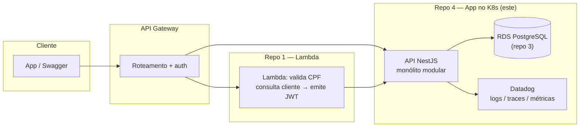

# Oficina Mecânica — Aplicação Principal (Fase 3)

> **Repo 4 de 4** — API NestJS executando em Kubernetes, parte do Tech Challenge da Pós-Tech FIAP (Fase 3).
> Esta é a aplicação principal do sistema de gestão de oficina mecânica.

## Visão geral

Sistema de gestão para oficina mecânica: clientes, veículos, serviços, peças,
ordens de serviço (OS), orçamentos, estoque e relatórios. **Monólito modular**
em NestJS com Clean Architecture, PostgreSQL (RDS em produção), observabilidade
Datadog e autenticação via Lambda (clientes, por CPF) + staff interno.

### Os 4 repositórios do grupo

| Repo | Escopo | Status |
|---|---|---|
| [techChallengePosTech-lambda](https://github.com/FernandoGreco/techChallengePosTech-lambda) | Lambda de auth por CPF (repo 1) | em desenvolvimento |
| [techChallengePosTech-k8s-infra](https://github.com/FernandoGreco/techChallengePosTech-k8s-infra) | Cluster K8s (Terraform, EC2, kubeadm) | em desenvolvimento |
| [techChallengePosTech-db-infra](https://github.com/FernandoGreco/techChallengePosTech-db-infra) | RDS PostgreSQL (Terraform) | vazio |
| **techChallengePosTech-Aplication** | **API + K8s manifests + CI/CD (este repo)** | **em desenvolvimento** |

## Arquitetura deste repositório



Ver [docs/architecture/componentes.md](docs/architecture/componentes.md) para o
diagrama C4-nível-2 completo e
[docs/architecture/sequencia-auth-os.md](docs/architecture/sequencia-auth-os.md)
para os fluxos de autenticação e abertura de OS.

## Tecnologias

- **NestJS 11** (Node.js, TypeScript) — monólito modular
- **Prisma** + PostgreSQL (RDS em produção)
- **JWT** — multi-issuer: Lambda (clientes, CPF) + staff interno (ver [RFC-003](docs/rfc/RFC-003-estrategia-autenticacao.md))
- **Datadog** (`dd-trace`) — APM, logs JSON, métricas de negócio (ver [RFC-004](docs/rfc/RFC-004-observabilidade-datadog.md))
- **Docker** + **Kubernetes** (manifests em [k8s/](k8s/))
- **GitHub Actions** — CI/CD

## Executando localmente

```bash
# 1. Subir Postgres (Docker)
docker compose up db -d

# 2. Configurar variáveis
cp .env.example .env

# 3. Instalar dependências e rodar migrations
npm install
npx prisma migrate deploy
npx prisma db seed   # opcional

# 4. Subir a aplicação
npm run start:dev
```

A API sobe em http://localhost:3000. Healthchecks: `/health` (liveness) e
`/ready` (readiness).

Para executar localmente o build de produção, com o mesmo banco e variáveis:

```bash
npm run build
npm run start:prod
```

O build gera `dist/main.js` e armazena o cache incremental dentro de `dist`,
para que o Nest limpe ambos juntos antes de cada compilação.

## Documentação da API (Swagger)

- Local: http://localhost:3000/api/docs
- Homolog: _a publicar após deploy_

## Autenticação

| Tipo de usuário | Como obter o token |
|---|---|
| **Cliente** | Lambda (repo 1) — auth por CPF, emite JWT HS256 |
| **Staff** (ADMIN/ATENDENTE/MECANICO) | `POST /auth/login` com email+senha |

Detalhes em [docs/rfc/RFC-003-estrategia-autenticacao.md](docs/rfc/RFC-003-estrategia-autenticacao.md).

Para desenvolvimento local, execute `npm run prisma:seed` para criar os
usuários de exemplo. O login do administrador em `POST /auth/login` usa:

```json
{
  "email": "admin@email.com",
  "senha": "123456"
}
```

Essas credenciais são apenas para desenvolvimento; não as utilize em produção.

## Testes

```bash
npm test           # unitários (261 testes)
npm run test:cov   # cobertura
npm run test:e2e   # e2e (requer Postgres local)
```

**Atenção:** a suíte E2E limpa as tabelas, incluindo usuários, no banco indicado
por `DATABASE_URL`. Execute-a somente em um banco exclusivo para testes.
Se ela tiver sido executada no banco de desenvolvimento, `npm run prisma:seed`
recria as contas de exemplo, mas não recupera os dados removidos.

## Deploy

- **CI** (`.github/workflows/`): lint, testes unitários + e2e, build, Docker build/push (GHCR)
- **CD**: `develop` → namespace homolog; `main` → namespace prod (via manifests [k8s/](k8s/))

## Documentação arquitetural

| Doc | Conteúdo |
|---|---|
| [docs/architecture/componentes.md](docs/architecture/componentes.md) | Diagrama de componentes (C4-nível-2) |
| [docs/architecture/sequencia-auth-os.md](docs/architecture/sequencia-auth-os.md) | Sequência: auth via CPF + abertura de OS |
| [docs/rfc/](docs/rfc/) | RFC-001 (nuvem) · RFC-002 (banco) · RFC-003 (auth) · RFC-004 (observabilidade) |
| [docs/adr/](docs/adr/) | ADR-001 (monólito Clean Arch) · ADR-002 (REST síncrono) · ADR-003 (HPA) · ADR-004 (logs) |
| [docs/database/modelo-er.md](docs/database/modelo-er.md) | Diagrama ER + justificativa do relacional |

## Branches

- `main` — produção (protegida, PR obrigatório)
- `develop` — homologação
- `feature/*` — desenvolvimento

## Licença

Projeto acadêmico — Pós-Tech FIAP (Tech Challenge, Fase 3).
