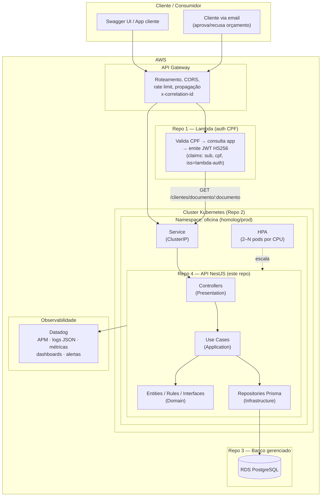

# Arquitetura de Componentes (C4 — Nível 2)

> Fase 3 — Visão de contêineres do sistema de gestão de oficina mecânica.
> Foco no **Repo 4 (aplicação principal)** e suas integrações externas.

## Diagrama

## Componentes e responsabilidades

### Repo 4 — API NestJS (este repositório)

| Componente | Camada | Responsabilidade |
|---|---|---|
| Controllers | Presentation | Receber HTTP, validar DTOs, retornar respostas |
| Use Cases | Application | Orquestrar regras de negócio por operação |
| Domain | Domain | Entities, rules (máquina de estados da OS, estoque), interfaces |
| Repositories (Prisma) | Infrastructure | Persistência; implementam as interfaces do domínio |
| JwtStrategy | Infrastructure | Valida JWT multi-issuer (Lambda × staff) — ver [RFC-003](../rfc/RFC-003-estrategia-autenticacao.md) |
| MetricsService | Shared | 5 métricas de negócio customizadas para o Datadog |
| LoggingModule | Shared | Logs JSON estruturados com correlation-id (nestjs-pino) |
| HealthController | Shared | `/health` (liveness) e `/ready` (readiness) para o K8s |

### Componentes externos

| Componente | Repo | Interação com este repo |
|---|---|---|
| **API Gateway** | compartilhado | Roteia tráfego, propaga `x-correlation-id`, aplica rate limit |
| **Lambda (auth CPF)** | repo 1 | Emite JWT HS256 (claims `sub`, `cpf`, `iss=lambda-auth`) após consultar `GET /clientes/documento/:documento` |
| **Cluster K8s** | repo 2 | Executa a app (Deployment + Service + HPA); probes em `/health` e `/ready` |
| **RDS PostgreSQL** | repo 3 | `DATABASE_URL` via Secret; `prisma migrate deploy` no deploy |
| **Datadog** | compartilhado | Recebe traces (dd-trace), logs JSON (stdout) e métricas customizadas (dogstatsd) |

## Decisões arquiteturais

- **Monólito modular Clean Architecture** — preservado da Fase 2 (ver [ADR-001](../adr/ADR-001-monolito-clean-architecture.md))
- **Comunicação síncrona REST via API Gateway** — ver [ADR-002](../adr/ADR-002-rest-sincrono-api-gateway.md)
- **Escalabilidade via HPA** — ver [ADR-003](../adr/ADR-003-hpa-escalabilidade.md)
- **Logs estruturados + correlation-id** — ver [ADR-004](../adr/ADR-004-logs-estruturados.md)

## Requisitos de infraestrutura

| Recurso | Detalhe |
|---|---|
| Probes | liveness `/health` (15s/20s), readiness `/ready` (5s/10s) |
| Recursos | requests 100m/128Mi; limits 500m/512Mi |
| HPA | min 2, max conforme CPU (ver [k8s/hpa.yaml](../../k8s/hpa.yaml)) |
| Secrets | `DATABASE_URL`, `JWT_SECRET`, `DD_API_KEY` via K8s Secret |
