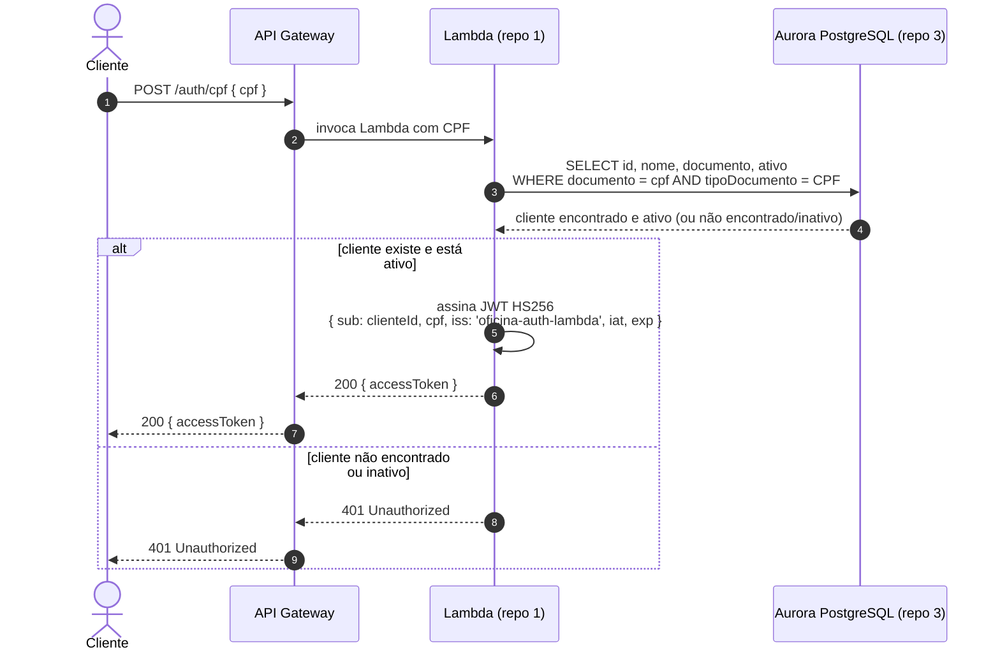
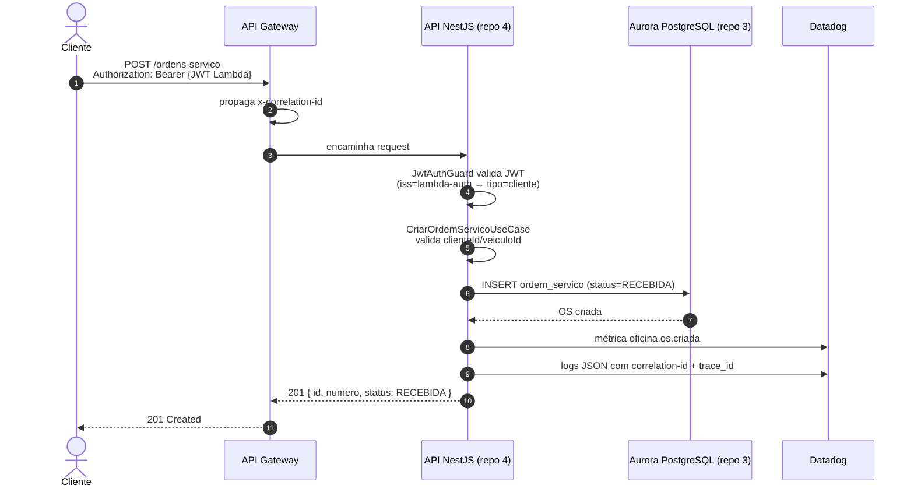
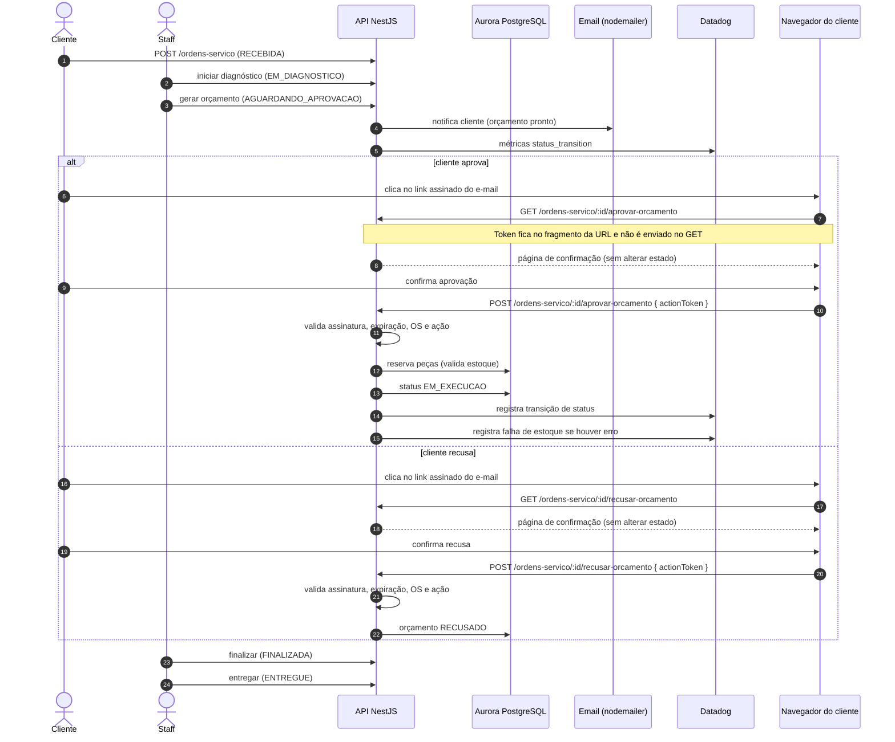

# Diagramas de Sequência — Auth via CPF e Abertura de OS

> Fase 3 — Fluxos críticos do sistema.

## 1. Autenticação de cliente via CPF (Lambda)

**Contrato C1** (ver [RFC-003](../rfc/RFC-003-estrategia-autenticacao.md)):
HS256, secret compartilhado, claims `sub`/`cpf`/`iat`/`exp`/`iss=oficina-auth-lambda`.

## 2. Abertura de OS autenticada

## 3. Fluxo completo da OS (visão de status)

A métrica `oficina.os.status_transition` conta as transições e inclui as tags
`de` e `para`. A duração por status é enviada separadamente pela métrica
histograma `oficina.os.tempo_status`, que alimenta o dashboard de tempo médio.
