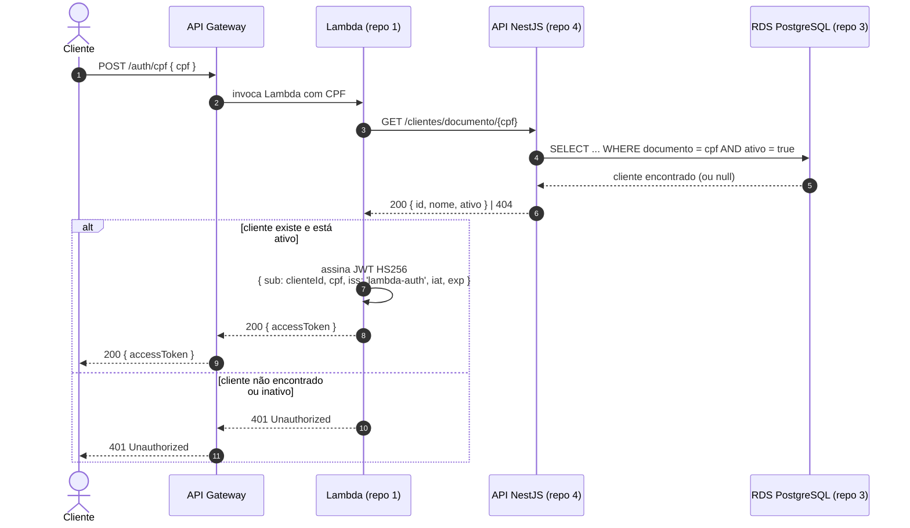
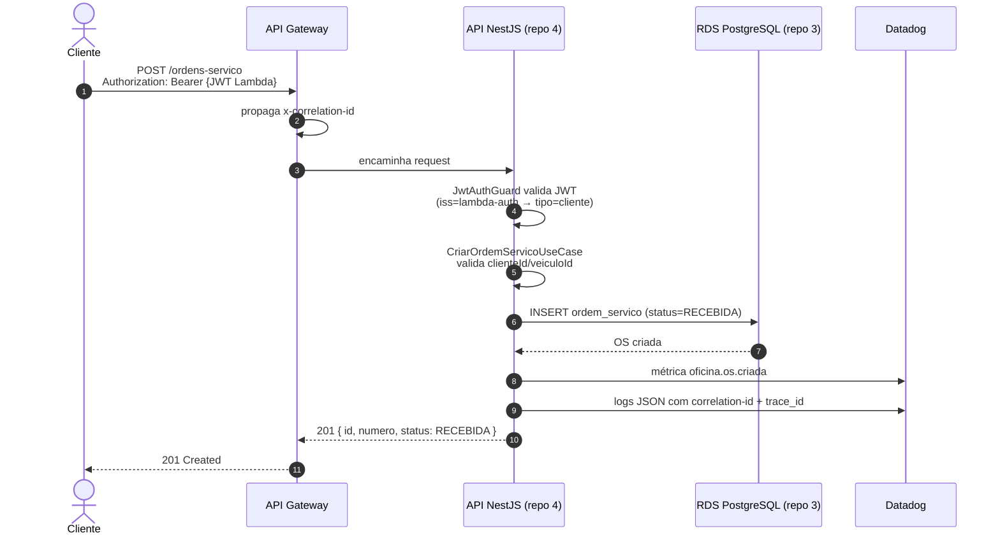

# Diagramas de Sequência — Auth via CPF e Abertura de OS

> Fase 3 — Fluxos críticos do sistema.

## 1. Autenticação de cliente via CPF (Lambda)



**Contrato C1** (ver [RFC-003](../rfc/RFC-003-estrategia-autenticacao.md)):
HS256, secret compartilhado, claims `sub`/`cpf`/`iat`/`exp`/`iss=lambda-auth`.

## 2. Abertura de OS autenticada



## 3. Fluxo completo da OS (visão de status)

```mermaid
sequenceDiagram
    autonumber
    actor Cliente
    actor Staff
    participant API as API NestJS
    participant DB as RDS PostgreSQL
    participant EMAIL as Email (nodemailer)
    participant DD as Datadog

    Cliente->>API: POST /ordens-servico (RECEBIDA)
    Staff->>API: iniciar diagnóstico (EM_DIAGNOSTICO)
    Staff->>API: gerar orçamento (AGUARDANDO_APROVACAO)
    API->>EMAIL: notifica cliente (orçamento pronto)
    API->>DD: métricas status_transition

    alt cliente aprova
        Cliente->>API: POST /ordens-servico/:id/aprovar-orcamento
        API->>DB: reserva peças (valida estoque)
        API->>DB: status EM_EXECUCAO
        API->>DD: status_transition; falha_estoque_insuficiente se erro
    else cliente recusa
        Cliente->>API: POST /ordens-servico/:id/recusar-orcamento
        API->>DB: orçamento RECUSADO
    end

    Staff->>API: finalizar (FINALIZADA)
    Staff->>API: entregar (ENTREGUE)
```

Cada transição emite a métrica `oficina.os.status_transition` (tags `de`/`para`)
para o Datadog — base do dashboard "tempo médio por status" (R9).
