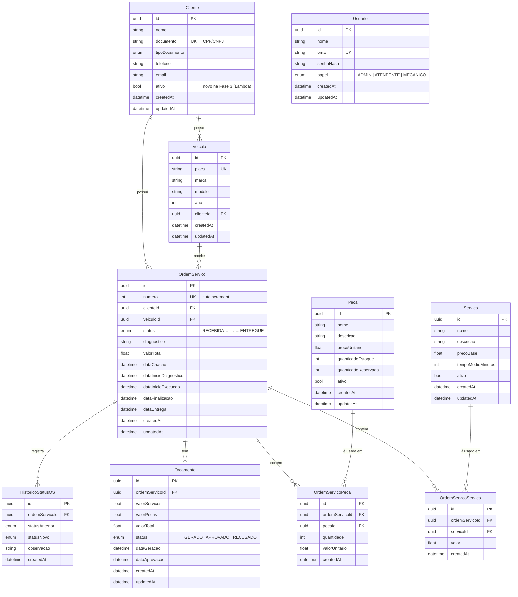

# Modelo de Dados — Diagrama ER e Justificativa

> Fase 3 — Banco de dados relacional (PostgreSQL/RDS). Fonte: [schema.prisma](../../prisma/schema.prisma).

## Justificativa do modelo relacional

O domínio da oficina mecânica é **inherentemente relacional**:

- **Integridade referencial** — OS depende de Cliente e Veículo; orçamento depende de OS; itens da OS dependem de Serviço/Peça. FKs garantem consistência.
- **Transações multi-agregado** — aprovação de orçamento atualiza orçamento, OS e estoque **atomicamente** (ver `aprovarOrcamento` no repository). Bancos NoSQL dificultam isso.
- **Máquina de estados** — histórico de status da OS é uma relação 1:N natural.
- **Consultas ricas** — relatórios (tempo médio por status) e listagens com joins e ordenação são naturais em SQL.

A escolha do relacional foi feita na Fase 2 (ADR-01) e **mantida** na Fase 3 —
ver [RFC-002](../rfc/RFC-002-banco-postgresql-rds.md).

## Diagrama ER

## Relacionamentos

| Relação | Cardinalidade | Descrição |
|---|---|---|
| Cliente ↔ Veículo | 1:N | Um cliente tem vários veículos |
| Cliente ↔ OS | 1:N | Um cliente abre várias OS |
| Veículo ↔ OS | 1:N | Um veículo recebe várias OS |
| OS ↔ Serviço | N:M via `OrdemServicoServico` | OS contém vários serviços (com valor no momento) |
| OS ↔ Peça | N:M via `OrdemServicoPeca` | OS consome várias peças (com quantidade e valor) |
| OS ↔ Orçamento | 1:N | Uma OS pode ter orçamentos (gerado, aprovado, recusado) |
| OS ↔ HistóricoStatus | 1:N | Máquina de estados auditável |

## Ajustes de modelo na Fase 3

| Mudança | Motivo | Migration |
|---|---|---|
| `Cliente.ativo` (Boolean, default `true`) | Lambda de auth por CPF precisa consultar existência **e** status antes de emitir JWT (RFC-003) | `20261018140000_add_ativo_to_cliente` |

## Enums

- `TipoDocumento`: CPF, CNPJ
- `StatusOS`: RECEBIDA → EM_DIAGNOSTICO → AGUARDANDO_APROVACAO → EM_EXECUCAO → FINALIZADA → ENTREGUE
- `StatusOrcamento`: GERADO, APROVADO, RECUSADO
- `PapelUsuario`: ADMIN, ATENDENTE, MECANICO
